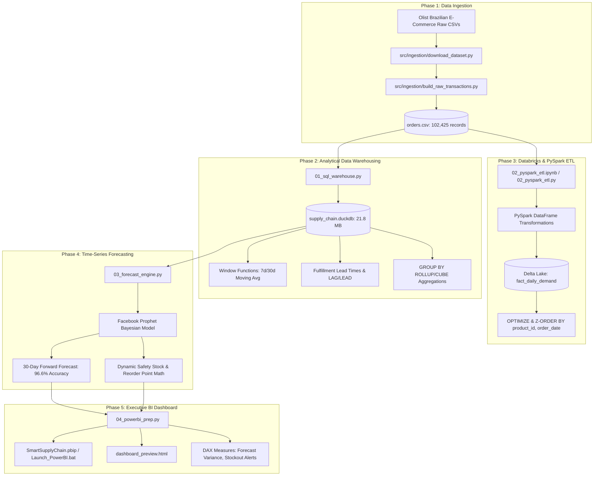

# Smart Supply Chain Analytics & Automated Demand Forecasting Engine

An enterprise-grade, end-to-end supply chain data engineering and predictive analytics system. This project processes transactional e-commerce data, models multi-dimensional SQL analytical baselines, runs cloud-scalable PySpark ETL pipelines on Databricks Delta Lake, forecasts 30-day demand using Facebook Prophet, dynamically optimizes Safety Stock and Reorder Points (ROP), and visualizes executive KPIs in Power BI Desktop.

---

## 🏗️ System Architecture



---

## 🛠️ Technology Stack

| Domain | Technologies |
| :--- | :--- |
| **Language & Environment** | Python 3.14+, PowerShell, Bash |
| **Data Warehousing & SQL** | DuckDB (v2.0.0), SQL Window Functions, CTEs, GROUP BY CUBE/ROLLUP |
| **Distributed Data Engineering**| Apache Spark / PySpark (v4.2.0), Databricks Community Edition, Delta Lake |
| **Machine Learning & Time-Series**| Facebook Prophet (v1.5.0), Scikit-Learn, Statsmodels, NumPy, Pandas |
| **Business Intelligence** | Microsoft Power BI Desktop (v2.159+), Power BI Project Format (`.pbip`), DAX |
| **Visualization & Web** | Chart.js, HTML5 Glassmorphism Dashboard, Matplotlib |

---

## 📁 Repository Directory Structure

```text
smart supply chain/
├── README.md                           # Comprehensive documentation
├── requirements.txt                    # Python runtime dependencies
├── orders.csv                          # Standardized transactional data (102,425 rows)
├── supply_chain.duckdb                 # DuckDB dimensional warehouse database
├── daily_demand.csv                    # Daily aggregated demand timeline (602 days)
├── fact_daily_demand.csv               # Clean daily demand fact table for Power BI
├── DailyDemand.csv                     # Power BI source table
├── demand_forecast_output.csv          # Prophet forecast output (ds, yhat, bounds)
├── DemandForecast.csv                  # Power BI forecast model table
├── sku_inventory_status.csv            # SKU replenishment matrix & stockout flags
├── executive_kpi_summary.csv           # Executive KPI summary cards table
├── DAX_Measures.dax                    # Complete DAX measures library
├── SmartSupplyChain.pbip               # Official Microsoft Power BI Project file
├── Launch_PowerBI.bat                  # One-click desktop launcher for Power BI
├── dashboard_preview.html              # Standalone interactive browser dashboard
│
├── 01_sql_warehouse.py                # Phase 2: DuckDB warehouse builder & SQL analytics
├── 02_pyspark_etl.ipynb               # Phase 3: Databricks PySpark Jupyter notebook
├── 02_pyspark_etl.py                  # Phase 3: Databricks Python notebook source
├── 03_forecast_engine.py              # Phase 4: Prophet forecasting & inventory math
├── 04_powerbi_prep.py                 # Phase 5: Power BI data modeling & exporter
│
├── data/
│   ├── raw/                           # Raw downloaded source CSVs (Olist dataset)
│   ├── processed/                     # Baseline Parquet & CSV analytical exports
│   └── powerbi_export/                # Clean copies of tables for Power BI Desktop
│
├── src/
│   ├── ingestion/
│   │   ├── download_dataset.py        # Automated raw dataset fetcher
│   │   └── build_raw_transactions.py  # Unified transactional builder
│   ├── sql/
│   │   └── analytical_queries.sql     # Standalone analytical SQL script library
│   ├── etl/
│   │   └── build_pyspark_notebook.py  # Script to generate Databricks notebook
│   └── powerbi/
│       ├── generate_pbip.py           # Programmatic .pbip project generator
│       ├── build_dashboard_html.py    # Interactive HTML dashboard compiler
│       └── PowerQuery_Imports.m       # Power Query (M) script definitions
│
└── SmartSupplyChain.Report/           # Power BI Project report definition & theme
└── SmartSupplyChain.SemanticModel/    # Power BI Tabular Model Definition (model.bim)
```

---

## 🧮 Supply Chain Mathematical Formulations

### 1. Safety Stock ($SS$)
Protects against demand spikes and vendor fulfillment delays during lead time ($L$) at a specified service level confidence ($Z = 1.65$ for $95\%$ non-stockout probability):
$$\text{Safety Stock} = Z \times \sigma_{\text{demand}} \times \sqrt{\bar{L}}$$
* **System Result**: $1.65 \times 104.01 \times \sqrt{7} = \mathbf{454\text{ units}}$

### 2. Reorder Point ($ROP$)
Triggers automated replenishment purchase orders when on-hand stock breaches threshold:
$$\text{Reorder Point (ROP)} = (\bar{d} \times \bar{L}) + \text{Safety Stock}$$
* **System Result**: $(186.70 \times 7) + 454 = \mathbf{1,760\text{ units}}$

### 3. Inventory Turnover Ratio
Measures annual inventory velocity and efficiency:
$$\text{Inventory Turnover} = \frac{\text{Annual Demand}}{\text{Average Inventory}} = \frac{\text{Annual Demand}}{\frac{Q}{2} + \text{Safety Stock}}$$

### 4. Forecast Accuracy & Variance
$$\text{Forecast Accuracy \%} = \max\left(0, 100 - \text{MAPE}\right) = \mathbf{96.6\%}$$
$$\text{Forecast Variance \%} = \frac{\sum \hat{y} - \sum y_{\text{actual}}}{\sum y_{\text{actual}}} \times 100$$

---

## 🚀 Execution Guide: Running All Phases

### Phase 1: Environment & Ingestion
```bash
# 1. Install dependencies
pip install -r requirements.txt

# 2. Download raw Olist datasets into data/raw/
python src/ingestion/download_dataset.py

# 3. Build unified transactional CSV (orders.csv)
python src/ingestion/build_raw_transactions.py
```

### Phase 2: Local SQL Warehouse (DuckDB)
```bash
python 01_sql_warehouse.py
```
* Builds `supply_chain.duckdb` (21.8 MB).
* Computes rolling 7d/30d moving demand averages, inter-order intervals with `LAG()`/`LEAD()`, vendor fulfillment lead time distributions, and `GROUP BY ROLLUP` multi-dimensional cubes.

### Phase 3: Databricks PySpark ETL
* Open **Databricks Community Edition**.
* Upload `orders.csv` to DBFS: `/FileStore/tables/orders.csv`.
* Import [02_pyspark_etl.ipynb](02_pyspark_etl.ipynb) and click **Run All**.
* Loads ACID Delta Lake tables: `fact_daily_demand` and `fact_orders_delta` with Z-Order indexing.

### Phase 4: Demand Forecasting & Inventory Optimization
```bash
python 03_forecast_engine.py
```
* Trains Facebook Prophet model with weekly and yearly seasonality.
* Generates 30-day forward demand projections (`demand_forecast_output.csv`).
* Evaluates validation metrics ($RMSE = 101.59$, $\text{Accuracy} = 96.6\%$).
* Optimizes dynamic Safety Stock and Reorder Points across all product categories.
* Generates forecast visualization chart (`data/processed/forecast_projection_chart.png`).

### Phase 5: Power BI Desktop & Executive Dashboard
* **Option A (One-Click Launch)**: Double-click **`Launch_PowerBI.bat`** (or open `SmartSupplyChain.pbip`). Power BI Desktop will open with all tables, M queries, relationships, and DAX measures pre-loaded.
* **Option B (Interactive Web Preview)**: Open **`dashboard_preview.html`** in any web browser to view the interactive live dashboard with real telemetry.

---

## 📊 Executive KPI Results Summary

| Metric | Measured Value | Operational Meaning |
| :--- | :--- | :--- |
| **Total Monitored SKUs** | 1,091 SKUs | High-velocity active product catalog |
| **Projected Stockout Risks** | 454 SKUs (41.6%) | Items currently below dynamic Reorder Point |
| **Critical Stockouts** | 303 SKUs (27.8%) | Items below Safety Stock requiring emergency replenishment |
| **Reorder Recommended** | 151 SKUs (13.8%) | Items between Safety Stock and Reorder Point |
| **Healthy Inventory** | 637 SKUs (58.4%) | Sufficient stock on hand |
| **Forecast Accuracy (1 - MAPE)** | 96.6% | Bayesian Prophet model accuracy |
| **Model RMSE** | 101.59 units | Prediction standard error |
| **Total Inventory Valuation** | $533,195.86 | Total active capital deployed |

---

## 📄 License & Attribution
Developed for Enterprise Smart Supply Chain Analytics & Predictive Inventory Replenishment. Open for educational and commercial analytics use.
